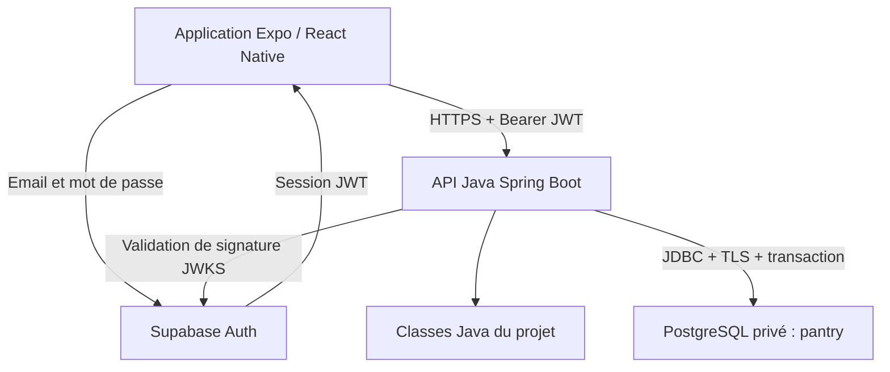

# Architecture de Campus Food Pantry

## Vue d'ensemble

L'application comporte trois parties. Expo affiche les écrans et envoie des requêtes HTTPS. Supabase Auth vérifie l'email et le mot de passe et remet une session contenant un jeton JWT. L'API Java vérifie ce jeton, exécute les règles du programme et enregistre les résultats dans PostgreSQL hébergé chez Supabase.

Le mobile ne se connecte jamais directement aux tables métier. Il n'embarque ni mot de passe de base ni clé privilégiée Supabase. La clé publishable et l'URL Supabase sont publiques par conception.

## Une API, concrètement

Une API est la porte HTTP de ton programme Java. Par exemple, `GET /api/v1/items` appelle `PantryService.items()`, reconstruit `Inventory` depuis la base, appelle son tri à bulles puis renvoie une liste JSON. L'écran transforme cette liste en cartes de produits.

`POST /api/v1/requests` reçoit seulement le panier et une clé de soumission unique. Java déduit l'utilisateur du JWT, vérifie les quantités puis appelle `RequestManager.submitRequest()`. Les mots de passe ne passent pas par cette API : Supabase Auth les traite.

## Responsabilité de chaque dossier

| Dossier | Rôle |
|---|---|
| legacy-console | Programme et tests d'origine conservés octet pour octet |
| backend/.../domain | Six classes existantes, avec package Java et adaptation de restauration FIFO |
| backend/.../api | Routes HTTP, validation des formulaires et erreurs JSON |
| backend/.../security | Validation JWT et administrateur unique |
| backend/.../service | Transactions JDBC, reconstruction des objets, appels métier et persistance |
| backend/.../db/migration | Schéma PostgreSQL versionné, applicable à une base vide |
| mobile | Écrans Expo, authentification Supabase, panier local et client HTTP |
| docs | Décisions, reprise du contexte, suivi et procédure de lancement |

## Données et authentification

| Table | Données |
|---|---|
| auth.users | Comptes gérés par Supabase Auth |
| pantry.profiles | UUID Auth, nom affiché ; aucun rôle modifiable par le client |
| pantry.item_lots | Identifiant stable, nom, catégorie, quantité, expiration, archivage |
| pantry.requests | Propriétaire, état, ordre FIFO, clé d'idempotence, décision |
| pantry.request_lines | Quantités et copie du nom/catégorie/date lors de la soumission |
| pantry.weekly_quotas | Unités approuvées par utilisateur et lundi de référence |
| pantry.stock_movements | Entrées/sorties de stock et demande correspondante |
| pantry.inspection_logs | Hygiène, produits abîmés, propreté et notes |

Le schéma `pantry` est privé : aucun droit pour `anon` ou `authenticated`. RLS est activé sur ses sept tables. Le rôle serveur `pantry_backend` a uniquement les permissions nécessaires. L'identifiant de connexion JDBC doit être un rôle serveur séparé qui hérite de `pantry_backend` ; ses secrets restent dans l'hébergement Java.

RLS ne remplace pas l'autorisation de l'API : le serveur agit pour les utilisateurs, contrôle leur propriété et réserve les opérations d'administration à l'UUID configuré. Le Java vérifie signature ES256/RS256, émetteur, expiration et audience `authenticated`. Une ancienne clé de signature HS256 nécessiterait une migration de signature dans Supabase, pas l'export de secrets vers le téléphone.

L'inscription est ouverte au niveau du produit. Pour envoyer les confirmations/réinitialisations à n'importe quelle adresse, le service email de Supabase doit être configuré : le fournisseur email par défaut impose des restrictions. Aucun SMTP externe ni administrateur n'est encore déclaré. Ne pas présenter ces étapes comme terminées.

## Transactions et reprise des classes

La base est la source durable de vérité. À chaque opération, le serveur acquiert un verrou transactionnel PostgreSQL commun, lit les données, reconstruit les objets et utilise les méthodes Java originales. Les objets ne sont pas partagés entre requêtes HTTP. Le verrou fonctionne aussi avec plusieurs instances Java ; il privilégie la simplicité pour ce petit projet de cours.

Lors d'une approbation : comparer l'ID demandé au premier de la file ; charger les quotas de la semaine courante ; appeler `approveNextRequest` ; enregistrer la demande, le stock, le quota et les mouvements dans la même transaction. En cas de déconnexion, la transaction annule toutes les écritures. Une nouvelle tentative sur un ID déjà traité retourne ce même résultat.

Une clé UUID d'idempotence par soumission empêche un double clic ou une retransmission réseau de créer deux demandes. La même clé avec un panier différent produit 409. Les demandes en attente peuvent dépasser le stock cumulé : chaque approbation est donc revérifiée. Une demande soumise dimanche et approuvée lundi compte dans la nouvelle semaine.

Le retrait des produits expirés supprime les objets de l'inventaire Java comme auparavant. En base, il archive les lots et remet leur quantité à zéro afin de garder l'historique des demandes et des mouvements.

## Contrat HTTP

Toutes les routes `/api/v1` nécessitent `Authorization: Bearer <access_token>`. Les routes `/admin` exigent en plus l'UUID administrateur. `/health` est public et indique seulement que le serveur HTTP répond. `/health/ready`, également public, vérifie l'accès PostgreSQL à `pantry.item_lots` sans exposer de données ; il retourne 503 si cet accès échoue. Render utilisera cette seconde route pour vérifier le déploiement.

| Méthode et route | Action |
|---|---|
| GET /me ; PATCH /me | Profil et quota ; modifier le nom affiché |
| GET /items?search=&category=&sort=name | Inventaire, recherche linéaire, tri à bulles |
| GET /items/{id} | Fiche d'un lot, recherche HashMap |
| POST /requests | Soumettre `{idempotencyKey, lines:[{itemId,quantity}]}` |
| GET /requests/mine | Historique personnel |
| GET /requests/{id} | Détail, accessible au propriétaire ou à Jules |
| GET /admin/requests | File FIFO et historique |
| POST /admin/requests/{id}/decision | `{action:"APPROVE"}` ou `{action:"DECLINE",reason:"..."}` |
| POST /admin/items | Créer un nouveau lot |
| POST /admin/items/{id}/restocks | Ajouter une quantité au même lot |
| POST /admin/inventory/remove-expired | Archiver les lots expirés |
| GET /admin/stock-movements | 500 derniers mouvements |
| GET /admin/reports/inventory | Rapport de stock, alertes et lots expirés |
| GET /admin/inspections ; POST /admin/inspections | 200 derniers contrôles ; nouveau contrôle |

Préfixer les routes du tableau par `/api/v1`. Réponses d'erreur : `{code,message,fields}`. 400 = formulaire invalide ; 401 = session invalide ; 403 = pas administrateur ; 404 = ressource absente ou demande d'une autre personne ; 409 = conflit de stock/quota/file/identifiant.

## Interface et distribution

L'hébergement retenu pour l'API est un web service Docker **Render Free**, région Ohio, via la connexion Render existante. Le Blueprint local ne déclare aucun autre service ; Auth et PostgreSQL restent dans Supabase. L'accès à l'espace Render est confirmé mais le service n'a pas encore été créé. Les paramètres et blocages sont dans `DEPLOYMENT_RENDER.md`. Le profil Spring `render` limite la mémoire et les connexions ; l'absence d'UUID admin interdit toutes les opérations administrateur.

Écrans membres : connexion, inscription, confirmation email, récupération de mot de passe, catalogue, recherche, filtres, fiche, panier, récapitulatif, résultat, historique, profil. Écrans administrateur : file, décision motivée, inventaire, ajout, réapprovisionnement, retrait des expirés, rapport et inspections. Le panier reste local et se vide au changement de compte.

Expo Go permet de charger la version de développement sur un iPhone gratuitement via le QR du serveur Expo. Le PC doit être allumé et le téléphone doit atteindre Expo ainsi que l'API Java (réseau local ou tunnel HTTPS). Ce n'est pas une application autonome distribuée par TestFlight.

Une exportation web Expo peut être hébergée puis ouverte dans Safari et ajoutée à l'écran d'accueil. Elle utilise la même API Java. Un lien public ne doit être annoncé qu'après un déploiement réellement vérifié.

TestFlight viendra plus tard : inscription Apple Developer, identifiant d'application, signature, build iOS EAS, soumission à App Store Connect et invitation du professeur. Aucun abonnement Apple n'est nécessaire pour commencer avec Expo Go.

## Limites de cette première version

Verrou global et chargement complet de l'inventaire/file : adaptés à une démonstration et une petite pantry, à revoir pour un trafic important. Pas encore de pagination de l'historique personnel ni d'outillage de suppression de compte. Ne pas annoncer une préparation à la production avant validation bout en bout, sauvegardes, limites de trafic et configuration email/hébergement.
